# React Application Patterns Technology Skill

## 1. Purpose & Activation

Provides React-specific architecture, routing, form integration, error recovery, TypeScript contract, testing, and SSR hydration guidance for Code Review Agent workflows.

**Activate when** code changes modify `.jsx`, `.tsx`, React Router (`react-router-dom`), Next.js router/navigation (`next/navigation`, `next/router`), form state and validation (`react-hook-form`, `formik`, native form actions), Error Boundaries (`componentDidCatch`, `react-error-boundary`), TypeScript React component props and discriminated unions, React Testing Library test suites (`@testing-library/react`), SSR/hydration boundaries, or React 18 to 19 migration paths.

**Do NOT activate solely because:**
- The task is about pure component decomposition, standard hooks, or memoization (delegate to [`skill-react-components-and-hooks`](../skill-react-components-and-hooks/SKILL.md)).
- The task is about data fetching lifecycles, cache invalidation, or Context/Redux store design (delegate to [`skill-react-data-and-state`](../skill-react-data-and-state/SKILL.md)).
- The task is about DOM XSS vulnerabilities, sanitization, or ARIA accessibility (delegate to [`skill-react-security-and-accessibility`](../skill-react-security-and-accessibility/SKILL.md)).
- The task is about generic backend routing or API design (delegate to backend engineering skills).

---

## 2. Scope & Progressive Disclosure

```mermaid
flowchart LR
    subgraph InScope [" React Application Patterns (This Skill)"]
        Router["Routing & Navigation: React Router, Next.js, Wildcards, Redirects"]
        Forms["Forms & Validation: Controlled/Uncontrolled, RHF, Formik, Dirty State"]
        ErrBound["Error Boundaries: Render vs Async Recovery, Boundary Scope"]
        TSContracts["TypeScript React: Discriminated Unions, Strict Prop Contracts"]
        RTLTesting["React Testing: RTL Async Sync, waitFor, User Queries"]
        SSRHydrate["SSR & Hydration: Browser APIs, Mismatch Prevention, React 18/19"]
    end

    subgraph Boundaries [" Delegated Engineering Responsibilities"]
        FROUT["skill-fe-routing-and-navigation -> Generic Route Modeling & Scoring"]
        FSTATE["skill-fe-state-management -> Generic State Machine & Scoring"]
        FTEST["skill-eng-test-quality -> Generic Test Coverage & Quality Scoring"]
        MAINT["skill-eng-maintainability -> Maintainability Scoring & Scorecard"]
    end

    InScope -.-> Boundaries
```

### Specialist Reference Mapping

| Review Area | Focus & Technology Semantics | Technology Reference |
|---|---|---|
| **Routing & Navigation** | Route config, wildcards, params, layout nesting, protected redirects, search param sync | [`references/routing-and-navigation.md`](references/routing-and-navigation.md) |
| **Forms & Validation** | Controlled/uncontrolled input state, RHF/Formik binding, validation lifecycle, form reset | [`references/forms-and-validation.md`](references/forms-and-validation.md) |
| **Error Boundaries & Recovery** | Render-phase error catching, async/event error handling boundaries, retry fallbacks | [`references/error-boundaries-and-recovery.md`](references/error-boundaries-and-recovery.md) |
| **TypeScript & Contracts** | Discriminated union props, event typing, generic component contracts, unsafe casts | [`references/typescript-and-contracts.md`](references/typescript-and-contracts.md) |
| **Testing & SSR / Versioning** | RTL async queries (`waitFor`, `findBy`), SSR hydration mismatch, React 18/19 compatibility | [`references/testing-and-ssr-compatibility.md`](references/testing-and-ssr-compatibility.md) |
| **Inspection Checklist** | Consolidated rule index `RAP01`–`RAP10` with detection, evidence & triage | [`references/checklist.md`](references/checklist.md) |

---

## 3. Technology Rules Index

| ID | Rule Name | Objective |
|---|---|---|
| `RAP01` | Route Configuration, Wildcards & Parameter Matching | Prevent unreachable routes, conflicting wildcard ordering, unvalidated route parameters, and broken nested layout outlet hierarchies. |
| `RAP02` | Route State Synchronization & Protected Redirects | Prevent infinite redirect loops, lost navigation state / query parameters, and unvalidated external redirect destinations during client navigation. |
| `RAP03` | Controlled vs. Uncontrolled Form State Transitions | Eliminate React runtime warnings and state corruption caused by switching input values between `undefined` and defined strings, or incorrect default value binding. |
| `RAP04` | Form Library Binding & Validation Lifecycle | Ensure robust field registration, sync validation triggers, dirty/touched state tracking, and prevent submitting invalid or already-submitting forms in React Hook Form / Formik. |
| `RAP05` | Error Boundary Granularity & Fallback Recovery | Ensure critical UI subtrees are isolated with granular error boundaries, provide actionable recovery mechanisms (reset triggers), and prevent entire application whiteouts. |
| `RAP06` | Async & Event Handler Error Boundary Propagation | Prevent silent failures by recognizing that React Error Boundaries do NOT catch errors in event handlers, asynchronous callbacks, or `setTimeout` without explicit state bridge/re-throw mechanisms. |
| `RAP07` | TypeScript Component Props & Discriminated Unions | Eliminate impossible component states, invalid prop combinations, and unsafe type assertions (`as Type`) by defining strict discriminated unions and generic constraints. |
| `RAP08` | React Testing Library Async Query & Wait Synchronization | Prevent flaky and misleading tests by using `findBy*` or `waitFor` for async updates, avoiding manual timeouts, and asserting on user-visible DOM semantics rather than implementation details. |
| `RAP09` | SSR Hydration Consistency & Browser API Isolation | Prevent React SSR hydration mismatches by isolating client-only APIs (`window`, `localStorage`, `navigator`) behind `useEffect` or client mounting guards. |
| `RAP10` | React Version & Ecosystem Compatibility | Ensure seamless interop across React 18 and 19 (e.g. `useActionState`, `useFormStatus`, ref as prop vs `forwardRef`, removal of deprecated lifecycle methods and peer dependencies). |

*Detailed criteria, evidence requirements, and remediation per rule are defined in [`references/checklist.md`](references/checklist.md).*

---

## 4. Framework Version & Ecosystem Matrix

Inspect `package.json` to identify active framework and routing/form/testing stack:

- **React Router v6 / v7**: Look for `createBrowserRouter`, `<RouterProvider>`, `<Outlet>`, `useNavigate`, `useSearchParams`, loaders and actions. Ensure route hierarchies and error elements (`errorElement`) are configured per sub-tree.
- **Next.js (App Router vs Pages Router)**: In App Router (`app/`), look for `layout.tsx`, `page.tsx`, `loading.tsx`, `error.tsx`, Server/Client component boundaries (`"use client"`), and `next/navigation` hooks (`useRouter`, `useSearchParams`, `usePathname`). In Pages Router (`pages/`), look for `getStaticProps`, `getServerSideProps`, `next/router`.
- **Form Libraries**: React Hook Form (`useForm`, `Controller`, `register`, `handleSubmit`) vs Formik (`useFormik`, `<Formik>`, `<Field>`) vs React 19 native Server Actions (`useActionState`, `useFormStatus`).
- **Testing Stack**: `@testing-library/react`, `@testing-library/user-event`, Jest / Vitest. Enforce user-event interactions and asynchronous DOM queries over direct DOM manipulation.
- **React 18 vs React 19**: React 18 uses `forwardRef` and `useTransition`. React 19 allows `ref` directly as a prop in function components, deprecates `forwardRef` and `ReactDOM.render`, and introduces native Actions and async transitions.

---

## 5. Review Workflow & Technology vs Engineering Scoring

- **Technology Skill Responsibility**: Provide React-specific application architecture patterns, concrete detection rules (`RAP01`–`RAP10`), precise code evidence requirements, and idiomatic modern React refactoring guidance.
- **Engineering Skill Responsibility**: Evaluate overarching architectural cohesion, state machine validity, test coverage metrics, calculate dimension scores (0.0–10.0 scale), and format findings into the Scorecard Aggregator schema.
- This technology skill does **not** generate a standalone numerical score.

---

## 6. Supporting References & Validation

- Routing & Navigation Guide: [`references/routing-and-navigation.md`](references/routing-and-navigation.md)
- Forms & Validation Guide: [`references/forms-and-validation.md`](references/forms-and-validation.md)
- Error Boundaries & Recovery Guide: [`references/error-boundaries-and-recovery.md`](references/error-boundaries-and-recovery.md)
- TypeScript & Contracts Guide: [`references/typescript-and-contracts.md`](references/typescript-and-contracts.md)
- Testing & SSR Guide: [`references/testing-and-ssr-compatibility.md`](references/testing-and-ssr-compatibility.md)
- Inspection Checklist: [`references/checklist.md`](references/checklist.md)
- Test Suite Validation: `python skills/technology/skill-react-application-patterns/validation/validate.py`

