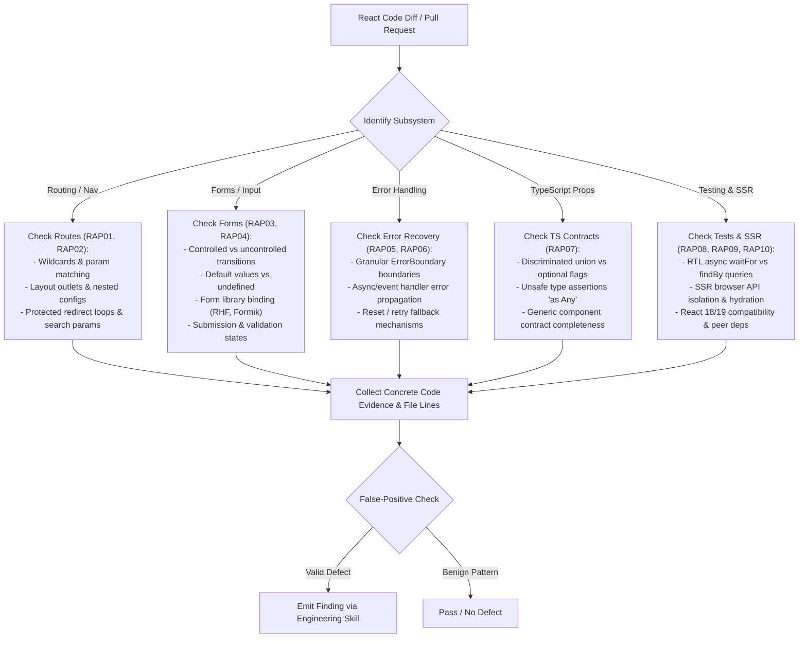

# React Application Patterns Checklist & Rule Catalog

This reference details the inspection procedures, triage flowchart, full rule catalog (`RAP01`–`RAP10`), evidence requirements, and false-positive prevention guidance for React application architecture, routing, forms, error handling, TypeScript contracts, testing, and SSR hydration.

---

## 1. Inspection Procedure & Triage Flowchart

---

## 2. Comprehensive Rule Catalog (`RAP01` – `RAP10`)

### RAP01: Route Configuration, Wildcards & Parameter Matching

- **Objective**: Ensure route trees are well-formed, catch-all/wildcard routes do not shadow specific routes, route params are validated, and nested layout `<Outlet />` tags are correctly placed.
- **Defect Symptoms**:
  - Catch-all route `path="*"` or `/users/:id` placed before specific static routes `/users/new` in legacy routers or improperly sorted routes causing unreachable views.
  - Missing `<Outlet />` in nested layout components in React Router v6/v7, causing child routes to never render.
  - Reading `useParams().id` without handling non-numeric or missing parameters before passing to downstream query hooks.
- **Evidence Requirements**: Show the route definition file (e.g. `routes.tsx` or App Router layout) and identify shadowed routes or missing layout outlets.
- **Remediation**: Reorder route definitions or rely on React Router v6 ranked matching; always include `<Outlet />` in shared layouts; parse and validate route params with Zod or type guards.

---

### RAP02: Route State Synchronization & Protected Redirects

- **Objective**: Prevent navigation loops, lost query parameters, and unvalidated external redirect destinations in client-side navigation.
- **Defect Symptoms**:
  - Calling `navigate('/login')` inside a component rendering the `/login` route itself or inside an un-guarded `useEffect` causing infinite navigation loops.
  - Hardcoding window redirects `window.location.href = returnUrl` where `returnUrl` is sourced from an untrusted query parameter without validating same-origin or protocol.
  - Stripping existing search parameters and filter state when navigating between tabs or sub-pages.
- **Evidence Requirements**: Code snippet of the navigation hook / redirect component showing the lack of loop prevention, missing query preservation, or unvalidated redirect target.
- **Remediation**: Use `<Navigate to="/login" replace state={{ from: location }} />` with proper route guards; sanitize return URLs; preserve search params using `useSearchParams`.

---

### RAP03: Controlled vs. Uncontrolled Form State Transitions

- **Objective**: Prevent inputs from switching between uncontrolled (initial `undefined` value) and controlled (`string` value) states during component lifecycle.
- **Defect Symptoms**:
  - `<input value={userData.name} />` where `userData.name` is initially `undefined` until async data resolves, triggering the React warning *"A component is changing an uncontrolled input to be controlled"*.
  - Overwriting user input drafts when reset logic triggers without checking form dirty state.
- **Evidence Requirements**: The input JSX element showing `value={propOrState}` without a fallback (e.g. `value={propOrState ?? ''}`).
- **Remediation**: Always provide a defined fallback for controlled inputs: `value={formData.field ?? ''}` or initialize form state objects with complete string defaults.

---

### RAP04: Form Library Binding & Validation Lifecycle

- **Objective**: Ensure proper form library binding (React Hook Form, Formik, React 19 Actions), prevent submission while validation is pending or invalid, and handle submission state correctly.
- **Defect Symptoms**:
  - Using React Hook Form without registering custom controlled components with `<Controller />`, losing validation integration.
  - Submitting forms via custom button clicks outside `handleSubmit`, bypassing schema validation (Zod / Yup).
  - Failing to disable submit buttons or show pending state during async submission, allowing duplicate form submissions.
- **Evidence Requirements**: Form component code showing missing `Controller`, unregistered fields, or bypass of `handleSubmit(onSubmit)`.
- **Remediation**: Wrap third-party UI pickers/inputs in `<Controller />`; use `isSubmitting` / `isValid` from `formState` to manage button states; always route submit events through form library handlers.

---

### RAP05: Error Boundary Granularity & Fallback Recovery

- **Objective**: Ensure application sub-trees (widgets, panels, data tables) are wrapped in localized Error Boundaries so that a single component crash does not unmount the entire application.
- **Defect Symptoms**:
  - A top-level root Error Boundary as the sole boundary in the app, turning any minor widget render crash into a full-page whiteout.
  - Error fallback components that display a dead end without a reset button or `onReset` recovery handler to retry rendering.
- **Evidence Requirements**: Layout/page JSX showing complex data-driven widgets without enclosing `<ErrorBoundary>` or `react-error-boundary` wrappers.
- **Remediation**: Wrap independent features/widgets in `<ErrorBoundary fallbackRender={...} onReset={...}>` with localized retry capabilities.

---

### RAP06: Async & Event Handler Error Boundary Propagation

- **Objective**: Catch and handle errors in event handlers, asynchronous callbacks, and `Promise` chains that React Error Boundaries cannot catch.
- **Defect Symptoms**:
  - Assuming an enclosing `<ErrorBoundary>` will catch an unhandled rejection in an `onClick` async function or `setTimeout` callback. When the error occurs, it goes unhandled, potentially leaving the UI in an inconsistent loading state.
  - Catching an async error in an event handler but neither setting component error state nor invoking `useErrorBoundary()` / `showBoundary(err)` from `react-error-boundary`.
- **Evidence Requirements**: Component code containing `async` event handlers or promise chains inside an `<ErrorBoundary>` without internal `try...catch` or error boundary bridging.
- **Remediation**: Wrap async handler bodies in `try...catch`, set local error state or invoke `const { showBoundary } = useErrorBoundary()` to propagate to the nearest boundary.

---

### RAP07: TypeScript Component Props & Discriminated Unions

- **Objective**: Model component prop contracts with discriminated unions and strict generics to eliminate impossible state representations and avoid unsafe type assertions (`as Any`, `as Type`).
- **Defect Symptoms**:
  - A component interface with multiple conflicting optional boolean props (e.g. `interface BannerProps { isSuccess?: boolean; isError?: boolean; isWarning?: boolean; errorMessage?: string; successData?: Data; }`), allowing combinations where both `isSuccess` and `isError` are true or `isError` is true but `errorMessage` is undefined.
  - Casting props with `as unknown as CustomType` inside render bodies to silence compiler errors instead of refining types with type guards.
- **Evidence Requirements**: TypeScript interface or component declaration showing ambiguous/conflicting optional props or unsafe `as` casts.
- **Remediation**: Refactor to discriminated unions: `type BannerProps = { variant: 'success'; data: Data } | { variant: 'error'; error: string } | { variant: 'warning'; message: string };`.

---

### RAP08: React Testing Library Async Query & Wait Synchronization

- **Objective**: Ensure React component tests use asynchronous queries (`findBy*`), `waitFor`, and user-centric event dispatching rather than flaky `setTimeout` delays or querySelector implementation leaks.
- **Defect Symptoms**:
  - Asserting on elements after an async action using synchronous `getBy*` without `await waitFor(...)` or `await findBy*`, leading to race conditions and test flakes.
  - Using arbitrary `await new Promise(r => setTimeout(r, 1000))` to wait for state updates instead of waiting for specific DOM conditions.
  - Querying internal component class names or test IDs when accessible roles (`getByRole('button', { name: ... })`) are available.
- **Evidence Requirements**: Test file showing arbitrary sleep timers, synchronous assertions on async elements, or fragile class selectors.
- **Remediation**: Replace with `const alert = await screen.findByRole('alert');` or `await waitFor(() => expect(screen.getByText(/saved/i)).toBeInTheDocument());` and `userEvent.setup()`.

---

### RAP09: SSR Hydration Consistency & Browser API Isolation

- **Objective**: Prevent React SSR / Next.js hydration mismatches by ensuring identical initial render output on server and client, and deferring browser-specific API access to effects or client-only guards.
- **Defect Symptoms**:
  - Accessing `typeof window !== 'undefined' ? window.innerWidth : 1024` directly during render phase, causing server render (1024) to mismatch client render on mobile screens, triggering React hydration errors.
  - Rendering non-deterministic values like `new Date().toLocaleTimeString()` or `Math.random()` during initial SSR render.
- **Evidence Requirements**: Component code executing browser API reads (`localStorage`, `window.location`, `navigator`) during top-level component render.
- **Remediation**: Defer browser reads to `useEffect` or an `isMounted` state guard, or use Next.js dynamic imports with `{ ssr: false }`.

---

### RAP10: React Version & Ecosystem Compatibility

- **Objective**: Ensure clean migration and API compatibility across React 18 and React 19, avoiding deprecated APIs and peer dependency conflicts.
- **Defect Symptoms**:
  - Using deprecated `defaultProps` on functional components in React 19 codebases (where default parameters should be used).
  - Using `forwardRef` unnecessarily in React 19 where `ref` is passed directly as a standard prop.
  - Calling legacy `ReactDOM.render` or `ReactDOM.hydrate` instead of `createRoot` / `hydrateRoot`.
- **Evidence Requirements**: Component files or entrypoints using deprecated React APIs incompatible with the target React version declared in `package.json`.
- **Remediation**: Use ES6 default parameter syntax for props; use `ref` as standard prop in React 19; migrate entry points to `createRoot`.

---

## 3. False-Positive Prevention Checklist

Before reporting any finding under `RAP01`–`RAP10`, verify all of the following:

1. **Error Boundaries & Async Errors**: Do NOT claim that adding standard `<ErrorBoundary>` will automatically catch promise rejections or `onClick` errors without `useErrorBoundary` / state bridging.
2. **TypeScript `any` / Casts**: Do NOT flag every type assertion (`as Type`) as a critical defect unless it creates an observable runtime crash risk or bypasses type safety in a shared public component API.
3. **Form Libraries**: Do NOT mandate third-party form libraries (React Hook Form or Formik) if the component is a simple single-field or uncomplex native form that handles state cleanly.
4. **Client-Side Protected Routes**: Do NOT treat client-side route guards as a backend vulnerability finding; client-side route protection is a UX navigation pattern. (Backend API authorization is reviewed separately).
5. **SSR Hydration Guards**: Do NOT flag `typeof window !== 'undefined'` checks if the component is explicitly a client-only module rendered via Next.js dynamic import with `{ ssr: false }` or rendered exclusively in a pure SPA (e.g. Vite/CRA without SSR).

