# React Components & Hooks Technology Skill

## 1. Purpose & Activation

Provides React-specific component architecture and React Hooks review rules, lifecycle semantics, dependency array mechanics, and reconciliation behavior for Code Review Agent workflows.

**Activate when** code changes modify `.jsx`, `.tsx`, React functional components, custom hooks (`use*`), `useState`, `useEffect`, `useMemo`, `useCallback`, `useRef`, `useContext`, `useId`, `useTransition`, `useDeferredValue`, component composition trees, collection rendering keys, or React effect cleanup.

**Do NOT activate solely because:**
- The task is about generic HTML semantic accessibility or ARIA attributes (delegate to [`skill-fe-accessibility`](../../engineering/skill-fe-accessibility/SKILL.md)).
- The task is about client-side routing, route loaders, or URL params (delegate to [`skill-fe-routing-and-navigation`](../../engineering/skill-fe-routing-and-navigation/SKILL.md)).
- The task is about frontend security boundaries like XSS sanitization or auth token storage (delegate to [`skill-fe-frontend-security`](../../engineering/skill-fe-frontend-security/SKILL.md)).
- The task is about HTTP client serialization or REST/GraphQL queries (delegate to [`skill-fe-api-integration`](../../engineering/skill-fe-api-integration/SKILL.md)).

---

## 2. Scope & Progressive Disclosure

```mermaid
flowchart LR
    subgraph InScope [" React Components & Hooks (This Skill)"]
        Comp["Component Design & Props Contracts"]
        Hooks["Hooks Correctness & Rules of Hooks"]
        Effects["Effect Setup, Cleanup & Strict Mode"]
        Recon["Keys, Identity & Reconciliation"]
        State["State Flow & Render Synchronization"]
    end

    subgraph Boundaries [" Delegated Engineering Responsibilities"]
        FCD["skill-fe-component-design -> Generic Component Boundaries & Layering"]
        FSM["skill-fe-state-management -> Generic State Architecture & Stores"]
        RL["skill-eng-resource-lifecycle -> Generic Resource Cleanup"]
        MAINT["skill-eng-maintainability -> Maintainability Scoring & Scorecard"]
    end

    InScope -.-> Boundaries
```

### Specialist Reference Mapping

| Review Area | Focus & Technology Semantics | Technology Reference |
|---|---|---|
| **Component Design & Props** | Cohesion, controlled vs uncontrolled, prop contracts, composition vs drilling | [`references/component-design.md`](references/component-design.md) |
| **Hooks Correctness & State** | Rules of hooks, stale closures, dependency arrays, state synchronization | [`references/hooks-correctness.md`](references/hooks-correctness.md) |
| **Effects & Resource Lifecycle** | Effect cleanup, timers/listeners, Strict Mode resiliency, abort controllers | [`references/effects-and-lifecycle.md`](references/effects-and-lifecycle.md) |
| **Reconciliation & State Flow** | Stable keys, index keys, unmounting state loss, derived state vs effects | [`references/reconciliation-and-state.md`](references/reconciliation-and-state.md) |
| **Inspection Checklist** | Consolidated rule index `REACT01`–`REACT10` with detection and remediation | [`references/checklist.md`](references/checklist.md) |

---

## 3. Technology Rules Index

| ID | Rule Name | Objective |
|---|---|---|
| `REACT01` | Component Cohesion & Single Responsibility | Eliminate components mixing business calculations, external API calls, and nested JSX rendering. |
| `REACT02` | Explicit Prop Contracts & Controlled State | Prevent conflicting prop modes, unhandled undefined callbacks, and hybrid controlled/uncontrolled state. |
| `REACT03` | Rules of Hooks & Call Placement | Enforce unconditional top-level hook execution; forbid hooks in loops, conditions, or callbacks. |
| `REACT04` | Exhaustive Dependencies & Stale Closures | Prevent stale state/prop captures in `useEffect`, `useCallback`, and `useMemo` without ad-hoc linter suppression. |
| `REACT05` | Derived State vs Redundant Effects | Replace state duplication and effect-driven recalculation with inline computed values or `useMemo`. |
| `REACT06` | Effect Lifecycle & Resource Cleanup | Ensure every subscription, timer, event listener, and async fetch handles teardown/cancellation. |
| `REACT07` | Custom Hook Boundaries & Contracts | Encapsulate reusable stateful logic into dedicated `use*` hooks with clear return tuples/objects. |
| `REACT08` | Stable Keys & Collection Identity | Prevent rendering index keys for mutable lists; ensure unique, stable item IDs across re-renders. |
| `REACT09` | Strict Mode & Idempotent Rendering | Ensure render functions and double-invoked effects remain pure and resilient under Strict Mode. |
| `REACT10` | Ref Semantics & Non-Reactive Escapes | Prevent DOM ref mutations during render phase; use refs strictly for imperative handles and mutable timers. |

*Detailed criteria, evidence requirements, and remediation per rule are defined in [`references/checklist.md`](references/checklist.md).*

---

## 4. Version Awareness & Framework Context

Inspect `package.json` to detect target React version and compiler capabilities:

- **React 16.8–17**: Base Hooks introduction (`useState`, `useEffect`, `useCallback`, `useMemo`, `useRef`, `useContext`).
- **React 18**: Automatic Batching, Strict Mode double-effect invocation, Concurrent features (`useTransition`, `useDeferredValue`, `useId`, `useSyncExternalStore`).
- **React 19+**: Action hooks (`useActionState`, `useFormStatus`, `useOptimistic`), `use()` for promises/context, React Compiler automatic memoization (do not force manual `useCallback`/`useMemo` when compiler is enabled).

*Framework Guardrail*: Do not enforce Next.js Server Components (`'use client'`) or React Router actions unless declared in dependencies.

---

## 5. Technology Guidance vs. Engineering Scoring

- **Technology Skill Responsibility**: Provide React execution semantics, hook lifecycle mechanics, concrete detection rules (`REACT01`–`REACT10`), and code evidence requirements.
- **Engineering Skill Responsibility**: Evaluate architectural impact, calculate dimension scores (0.0–10.0 scale), enforce deduction formulas, and format findings in the Scorecard Aggregator schema.
- This technology skill does **not** generate a standalone numerical score.

---

## 6. Supporting References & Validation

- **Inspection Checklist**: [`references/checklist.md`](references/checklist.md) — Comprehensive checklist and rule catalog.
- **Component Design Reference**: [`references/component-design.md`](references/component-design.md)
- **Hooks Correctness Reference**: [`references/hooks-correctness.md`](references/hooks-correctness.md)
- **Effects & Lifecycle Reference**: [`references/effects-and-lifecycle.md`](references/effects-and-lifecycle.md)
- **Reconciliation Reference**: [`references/reconciliation-and-state.md`](references/reconciliation-and-state.md)
- **Validation Test Suite**: [`validation/test-suite.json`](validation/test-suite.json)

