# React Data & State Technology Skill

## 1. Purpose & Activation

Provides React-specific data-fetching semantics, state ownership boundaries, server-state cache synchronization, mutation integrity, and asynchronous race condition rules for Code Review Agent workflows.

**Activate when** code changes modify data fetching in React (`fetch`, `axios`, `useEffect`, custom data hooks), server-state caching libraries (TanStack Query / React Query, SWR, RTK Query), state containers (Zustand, Redux, Context API, Jotai, Recoil), async mutations, optimistic UI updates, pagination/cursor loading, or client-side persistence and hydration (`localStorage`, `sessionStorage`, `redux-persist`).

**Do NOT activate solely because:**
- The task is about generic HTML component markup, basic props contracts, or Rules of Hooks ordering (delegate to [`skill-react-components-and-hooks`](../skill-react-components-and-hooks/SKILL.md) and [`skill-fe-component-design`](../../engineering/skill-fe-component-design/SKILL.md)).
- The task is about client-side routing, route loaders, or URL synchronization (delegate to [`skill-fe-routing-and-navigation`](../../engineering/skill-fe-routing-and-navigation/SKILL.md)).
- The task is about backend API schemas or server endpoint definitions (delegate to [`skill-be-rpc-api-design`](../../engineering/skill-be-rpc-api-design/SKILL.md)).
- The task is about generic error boundaries without data state implications (delegate to [`skill-eng-error-handling`](../../engineering/skill-eng-error-handling/SKILL.md)).

---

## 2. Scope & Progressive Disclosure

```mermaid
flowchart LR
    subgraph InScope [" React Data & State (This Skill)"]
        StateOwn["State Ownership & Invariants"]
        AsyncRace["Async Race Conditions & Cancellation"]
        StatusTrans["Loading, Error & Empty Transitions"]
        ServerCache["Server Cache & Query Invalidation"]
        Mutations["Mutations & Optimistic Rollbacks"]
        Paging["Pagination & Infinite Loading"]
        Persist["Persistence & Hydration"]
    end

    subgraph Boundaries [" Delegated Engineering Responsibilities"]
        FSM["skill-fe-state-management -> Generic State Principles & Store Topologies"]
        API["skill-fe-api-integration -> Network Protocols & Request Payloads"]
        RL["skill-eng-resource-lifecycle -> System Handles & Cleanup Rules"]
        ERR["skill-eng-error-handling -> Generic Catch & Fallbacks"]
    end

    InScope -.-> Boundaries
```

### Specialist Reference Mapping

| Review Area | Focus & Technology Semantics | Technology Reference |
|---|---|---|
| **State Ownership & Invariants** | Competing sources of truth, derived state, state mutations, context scoping | [`references/state-ownership-and-invariants.md`](references/state-ownership-and-invariants.md) |
| **Data Fetching & Race Conditions** | Async sequencing, `AbortController`, stale response overwrites, request lifecycles | [`references/fetching-and-race-conditions.md`](references/fetching-and-race-conditions.md) |
| **Server State & Caching** | Query key completeness, TanStack Query/SWR cache invalidation, freshness | [`references/server-state-and-caching.md`](references/server-state-and-caching.md) |
| **Mutations & Optimistic Updates** | Rollback integrity, duplicate submission guards, authoritative reconciliation | [`references/mutations-and-optimistic-ui.md`](references/mutations-and-optimistic-ui.md) |
| **Pagination & Persistence** | Filter synchronization, cursor tracking, storage migrations, logout clearance | [`references/pagination-and-persistence.md`](references/pagination-and-persistence.md) |
| **Inspection Checklist** | Consolidated rule index `REACT-DATA-01`–`REACT-DATA-10` with detection/remediation | [`references/checklist.md`](references/checklist.md) |

---

## 3. Technology Rules Index

| ID | Rule Name | Objective |
|---|---|---|
| `RDS01` | State Ownership & Single Source of Truth | Prevent duplicate representations of server/local data and conflicting state stores. |
| `RDS02` | Immutable State Updates & Invariant Safety | Eliminate direct object/array mutations and impossible multi-flag state combinations. |
| `RDS03` | Async Sequence Safety & Request Cancellation | Prevent out-of-order async responses from overwriting newer search, filter, or entity selections. |
| `RDS04` | Request Status & Tri-State UI Transitions | Ensure distinct, non-overlapping representation of loading, error, empty, and success states. |
| `RDS05` | Complete Query Keys & Cache Scope | Ensure query keys encompass all parameters affecting returned data (filters, pagination, user scope). |
| `RDS06` | Post-Mutation Cache Invalidation & Freshness | Invalidate or update relevant queries after create/update/delete operations to prevent stale UI. |
| `RDS07` | Optimistic Updates & Safe Rollback | Capture previous snapshots and ensure failed mutations cleanly restore authoritative state. |
| `RDS08` | Duplicate Submission & Mutation Locks | Prevent rapid multi-click submissions on non-idempotent mutations without blocking UI recovery. |
| `RDS09` | Pagination State & Filter Synchronization | Reset page/cursor tokens when search filters change; prevent appending stale page records. |
| `RDS10` | Persisted State Sanitization & Schema Migration | Purge sensitive auth/tenant data on logout and validate persisted storage schemas. |

*Detailed criteria, evidence requirements, and remediation per rule are defined in [`references/checklist.md`](references/checklist.md).*

---

## 4. Library & Framework Awareness

Inspect `package.json` to detect active data-fetching and state management dependencies:

- **Native `fetch` / Axios with `useEffect`**: Check for `AbortController`, active response flags, and loading/error status transitions.
- **TanStack Query (React Query v4/v5)**: Validate query keys (`queryKey: ['todos', filter]`), `useMutation` `onMutate` rollback snapshots, `invalidateQueries`, and `gcTime`/`staleTime` semantics.
- **SWR**: Inspect cache keys, `mutate()` revalidation, bound vs global mutators, and deduplication intervals.
- **Redux Toolkit / RTK Query**: Validate `providesTags` and `invalidatesTags` cache relationships, slice immutability (Immer), and extraReducers builders.
- **Zustand / Jotai / Recoil**: Verify atomic state selectors, subscriber isolation, and store reset handlers on logout.

*Rule Applicability Guardrail*: Do not require an application to adopt a third-party caching library if vanilla React state and hooks are sufficient and correctly implemented.

---

## 5. Technology Guidance vs. Engineering Scoring

- **Technology Skill Responsibility**: Provide React state and data-fetching mechanics, library-specific cache rules (`RDS01`–`RDS10`), false-positive safeguards, and code evidence requirements.
- **Engineering Skill Responsibility**: Evaluate architectural impact, calculate dimension scores (0.0–10.0 scale), enforce deduction formulas, and format findings in the Scorecard Aggregator schema.
- This technology skill does **not** generate a standalone numerical score.

---

## 6. Supporting References & Validation

- **Inspection Checklist**: [`references/checklist.md`](references/checklist.md) — Comprehensive checklist and rule catalog.
- **State Ownership Reference**: [`references/state-ownership-and-invariants.md`](references/state-ownership-and-invariants.md)
- **Fetching & Race Conditions**: [`references/fetching-and-race-conditions.md`](references/fetching-and-race-conditions.md)
- **Server State & Caching**: [`references/server-state-and-caching.md`](references/server-state-and-caching.md)
- **Mutations & Optimistic UI**: [`references/mutations-and-optimistic-ui.md`](references/mutations-and-optimistic-ui.md)
- **Pagination & Persistence**: [`references/pagination-and-persistence.md`](references/pagination-and-persistence.md)
- **Validation Test Suite**: [`validation/test-suite.json`](validation/test-suite.json)

