# React Rendering & Performance Technology Skill

## 1. Purpose & Activation

Provides React-specific rendering mechanics, reconciliation semantics, referential stability rules, context propagation efficiency, and scheduling guidance for Code Review Agent workflows.

**Activate when** code changes modify `.jsx`, `.tsx`, React functional components, `useMemo`, `useCallback`, `React.memo`, `useContext` provider values, `useSyncExternalStore`, `useTransition`, `useDeferredValue`, large list rendering, Suspense boundaries, or SSR hydration performance.

**Do NOT activate solely because:**
- The task is about generic HTTP caching or API query deduplication (delegate to [`skill-react-data-and-state`](../skill-react-data-and-state/SKILL.md) or [`skill-fe-api-integration`](../../engineering/skill-fe-api-integration/SKILL.md)).
- The task is about component composition boundaries or prop interfaces (delegate to [`skill-react-components-and-hooks`](../skill-react-components-and-hooks/SKILL.md) or [`skill-fe-component-design`](../../engineering/skill-fe-component-design/SKILL.md)).
- The task is about global state persistence or store structure (delegate to [`skill-fe-state-management`](../../engineering/skill-fe-state-management/SKILL.md)).
- The task is about bundle size, tree-shaking, or asset compression (delegate to [`skill-eng-performance`](../../engineering/skill-eng-performance/SKILL.md)).

---

## 2. Scope & Progressive Disclosure

```mermaid
flowchart LR
    subgraph InScope [" React Rendering & Performance (This Skill)"]
        Render["Render Cycles & Pure Render Phase"]
        Identity["Component Identity & Reconciliation"]
        Memo["Referential Stability & Memoization"]
        Context["Context Value Splitting & Consumers"]
        Lists["Collection Scale & Virtualization"]
        Schedule["Transitions, Scheduling & Hydration"]
    end

    subgraph Boundaries [" Delegated Engineering Responsibilities"]
        PERF["skill-eng-performance -> Overall Performance Scoring & Core Web Vitals"]
        COMP["skill-react-components-and-hooks -> Hook Rules & Basic Lifecycle"]
        DATA["skill-react-data-and-state -> Server Caching & Async State"]
        MAINT["skill-eng-maintainability -> Maintainability Scoring & Scorecard"]
    end

    InScope -.-> Boundaries
```

### Specialist Reference Mapping

| Review Area | Focus & Technology Semantics | Technology Reference |
|---|---|---|
| **Render Cycles & Identity** | Render phase purity, inline component definitions, remounting, key stability | [`references/render-behavior-and-identity.md`](references/render-behavior-and-identity.md) |
| **Memoization & Stability** | `useMemo`, `useCallback`, `React.memo`, memoization defeat, comparison costs | [`references/memoization-and-stability.md`](references/memoization-and-stability.md) |
| **Context & Subscriptions** | Context provider value stability, context splitting, `useSyncExternalStore` | [`references/context-and-subscriptions.md`](references/context-and-subscriptions.md) |
| **Collections & Scale** | Large collections, per-item allocations, windowing/virtualization criteria | [`references/collections-and-virtualization.md`](references/collections-and-virtualization.md) |
| **Transitions & Scheduling** | `useTransition`, `useDeferredValue`, Suspense boundaries, hydration mismatches | [`references/transitions-and-scheduling.md`](references/transitions-and-scheduling.md) |
| **Inspection Checklist** | Consolidated rule index `RRP01`–`RRP10` with detection, evidence & triage | [`references/checklist.md`](references/checklist.md) |

---

## 3. Technology Rules Index

| ID | Rule Name | Objective |
|---|---|---|
| `RRP01` | Render Phase Purity & Side-Effect Free Execution | Prevent state updates or external side effects during render phase triggering re-render cascades. |
| `RRP02` | Component Identity & Remount Prevention | Prevent declaring components inside parent render functions which destroys component identity and resets state. |
| `RRP03` | Reconciliation & Key Stability | Prevent unstable or index keys on dynamic collections causing DOM recreation and state corruption. |
| `RRP04` | Referential Stability & Effective Memoization | Prevent defeating `React.memo`/`useMemo` via unstable object/array/closure allocations, and eliminate pointless memoization. |
| `RRP05` | Context Provider Value Stability & Splitting | Prevent unmemoized Context Provider values causing re-render storms across all consuming components. |
| `RRP06` | Expensive In-Render Computations | Prevent executing unmemoized CPU-heavy transformations, sorting, or filtering on high-frequency render paths. |
| `RRP07` | Large Collection Rendering & Virtualization | Ensure collections at scale implement windowing or virtualization when DOM node count causes scroll jank. |
| `RRP08` | Non-Blocking Transitions & Responsive Inputs | Use `useTransition` or `useDeferredValue` for heavy non-urgent UI updates to prevent blocking user input. |
| `RRP09` | External Store Subscriptions & Fine-Grained Selectors | Use `useSyncExternalStore` with stable selectors to avoid tearing and excessive re-renders from global state. |
| `RRP10` | SSR Hydration & Render Recovery | Prevent client/server markup mismatches, redundant post-mount renders, and cascading hydration costs. |

*Detailed criteria, evidence requirements, and remediation per rule are defined in [`references/checklist.md`](references/checklist.md).*

---

## 4. Version Awareness & Optimization Architecture

Inspect `package.json` to detect target React version and compiler capabilities:

- **React 16.8–17**: Standard Hooks runtime. Manual `useMemo`/`useCallback` required for referential stability across `React.memo` boundaries.
- **React 18**: Automatic batching across promises and timeouts. Concurrent rendering features (`useTransition`, `useDeferredValue`, `useSyncExternalStore`). Strict Mode double-invokes render & effects in dev.
- **React 19+ / React Compiler**: Automatic memoization when React Compiler (`babel-plugin-react-compiler` or Next.js `reactCompiler: true`) is enabled. Do not flag missing `useMemo`/`useCallback` when compiler is active.

*Framework Guardrails*: Conditionalize Next.js Server Components, Remix defer/streaming, or React Virtualized/TanStack Virtual on actual package presence.

---

## 5. Technology Guidance vs. Engineering Scoring

- **Technology Skill Responsibility**: Provide React render cycle mechanics, reconciliation semantics, concrete detection rules (`RRP01`–`RRP10`), and code evidence requirements.
- **Engineering Skill Responsibility**: Evaluate architectural impact, calculate dimension scores (0.0–10.0 scale), enforce deduction formulas, and format findings in the Scorecard Aggregator schema.
- This technology skill does **not** generate a standalone numerical score.

---

## 6. Supporting References & Validation

- **Inspection Checklist**: [`references/checklist.md`](references/checklist.md) — Comprehensive checklist and rule catalog.
- **Render Cycles & Identity Reference**: [`references/render-behavior-and-identity.md`](references/render-behavior-and-identity.md)
- **Memoization & Stability Reference**: [`references/memoization-and-stability.md`](references/memoization-and-stability.md)
- **Context & Subscriptions Reference**: [`references/context-and-subscriptions.md`](references/context-and-subscriptions.md)
- **Collections & Virtualization Reference**: [`references/collections-and-virtualization.md`](references/collections-and-virtualization.md)
- **Transitions & Scheduling Reference**: [`references/transitions-and-scheduling.md`](references/transitions-and-scheduling.md)
- **Validation Test Suite**: [`validation/test-suite.json`](validation/test-suite.json)

