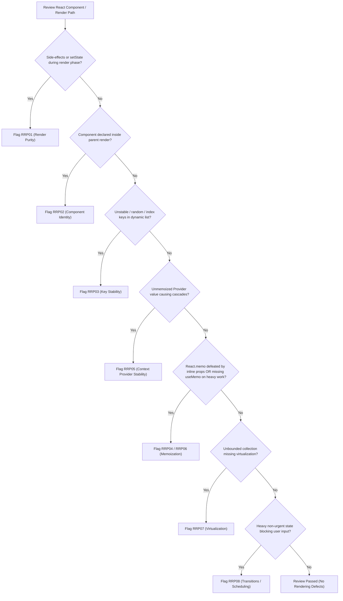

# React Rendering & Performance Review Checklist

## 1. Review Procedure & Triage Flow

---

## 2. Comprehensive Rule Catalog (`RRP01`–`RRP10`)

### `RRP01`: Render Phase Purity & Side-Effect Free Execution
- **Severity**: HIGH | **Confidence**: HIGH
- **Requirement**: The render phase must remain pure without modifying external state, mutating DOM, or calling state setters.
- **Evidence**: Component body calls `setState()` directly, mutates global variables, or triggers non-idempotent side effects outside `useEffect` / handlers.
- **Remediation**: Move side effects into `useEffect` hooks or user event callbacks.

### `RRP02`: Component Identity & Remount Prevention
- **Severity**: HIGH | **Confidence**: HIGH
- **Requirement**: Never declare functional or class components inside the render body of another component.
- **Evidence**: Function component declaration (e.g. `function Child() { ... }` or `const Child = () => ...`) nested inside a parent component function body.
- **Remediation**: Hoist nested component definition to top-level module scope.

### `RRP03`: Reconciliation & Key Stability
- **Severity**: HIGH | **Confidence**: HIGH
- **Requirement**: Use stable, unique entity IDs for list items across renders.
- **Evidence**: `key={Math.random()}`, `key={crypto.randomUUID()}` generated in render, or `key={index}` on reorderable/mutable collections.
- **Remediation**: Use unique item ID (e.g. `key={item.id}`).

### `RRP04`: Referential Stability & Effective Memoization
- **Severity**: MEDIUM | **Confidence**: HIGH
- **Requirement**: Ensure props passed to `React.memo` components are referentially stable, and avoid pointless memoization of primitives.
- **Evidence**: Inline object literals, array literals, or arrow functions passed directly to `React.memo` wrapped child components.
- **Remediation**: Wrap callbacks in `useCallback`, hoist constants, or memoize objects with `useMemo`.

### `RRP05`: Context Provider Value Stability & Splitting
- **Severity**: HIGH | **Confidence**: HIGH
- **Requirement**: Memoize Context Provider value objects when provider holds state or re-renders frequently.
- **Evidence**: `<MyContext.Provider value={{ a, b, handleAction }}>` without `useMemo` in a component containing local state.
- **Remediation**: Wrap provider `value` in `useMemo([a, b, handleAction])` or split high-frequency values into dedicated contexts.

### `RRP06`: Expensive In-Render Computations
- **Severity**: HIGH | **Confidence**: HIGH
- **Requirement**: Heavy synchronous transformations, filtering, sorting, or data formatting must be memoized with `useMemo`.
- **Evidence**: Multi-step array transforms, regex searches, or sorting over large datasets in render path without `useMemo`.
- **Remediation**: Wrap expensive calculation in `useMemo` with minimal required dependencies.

### `RRP07`: Large Collection Rendering & Virtualization
- **Severity**: HIGH | **Confidence**: MEDIUM
- **Requirement**: Virtualize unbounded or very large scrollable lists (1,000+ items).
- **Evidence**: Unwindowed `.map()` rendering thousands of complex DOM rows inside a fixed-height scroll container.
- **Remediation**: Integrate `@tanstack/react-virtual` or `react-window`.

### `RRP08`: Non-Blocking Transitions & Responsive Inputs
- **Severity**: MEDIUM | **Confidence**: HIGH
- **Requirement**: Keep direct user interactions responsive by marking heavy secondary UI updates as transitions.
- **Evidence**: Typing handler updates both text input and runs heavy blocking subtree render synchronously in React 18+.
- **Remediation**: Wrap heavy secondary update in `startTransition(() => { ... })`.

### `RRP09`: External Store Subscriptions & Fine-Grained Selectors
- **Severity**: MEDIUM | **Confidence**: HIGH
- **Requirement**: External stores must be subscribed to via `useSyncExternalStore` with stable snapshot extractors.
- **Evidence**: Ad-hoc `useEffect` + `useState` listeners on mutable stores without tearing protection.
- **Remediation**: Refactor to `useSyncExternalStore(subscribe, getSnapshot)`.

### `RRP10`: SSR Hydration & Render Recovery
- **Severity**: HIGH | **Confidence**: HIGH
- **Requirement**: Prevent client/server markup mismatches caused by browser-only values in initial render.
- **Evidence**: Accessing `window`, `localStorage`, or client-locale timestamps directly in SSR component JSX.
- **Remediation**: Defer client-only rendering until after mount via `useEffect` or server snapshots.

---

## 3. False-Positive Filtering Checklist

Before raising any finding, verify:
- [ ] Is this actually causing repeated expensive work, or is it a trivial lightweight re-render?
- [ ] Is React Compiler active in this project? If yes, manual `useMemo`/`useCallback` omission is not a defect.
- [ ] Is the list static and never reordered? If yes, index key is permissible.
- [ ] Is the collection small (< 50 items)? If yes, do not recommend virtualization.
- [ ] Does the component wrap native HTML elements only? If yes, unmemoized inline callbacks are completely harmless.

