# React Security & Accessibility Technology Skill

## 1. Purpose & Activation

Provides React-specific security vulnerability detection, safe HTML/URL sink handling, accessible JSX semantics, keyboard interaction patterns, and focus management guidance for Code Review Agent workflows.

**Activate when** code changes modify `.jsx`, `.tsx`, React components using `dangerouslySetInnerHTML`, dynamic `href`/`src` attributes, `useNavigate`/`<Link>`, authentication state or browser storage, `window.postMessage`, click handlers on non-interactive elements, form inputs and validation messages, modal dialogs, portals, or ARIA attributes.

**Do NOT activate solely because:**
- The task is about generic backend SQL injection or server authentication (delegate to [`skill-fe-frontend-security`](../../engineering/skill-fe-frontend-security/SKILL.md) or backend security skills).
- The task is about pure WCAG contrast formulas or global CSS stylesheets without React component context (delegate to [`skill-fe-accessibility`](../../engineering/skill-fe-accessibility/SKILL.md)).
- The task is about React hook dependency correctness or rendering cycles (delegate to [`skill-react-components-and-hooks`](../skill-react-components-and-hooks/SKILL.md) or [`skill-react-rendering-and-performance`](../skill-react-rendering-and-performance/SKILL.md)).

---

## 2. Scope & Progressive Disclosure

```mermaid
flowchart LR
    subgraph InScope [" React Security & Accessibility (This Skill)"]
        SecXSS["React Security: XSS & dangerouslySetInnerHTML"]
        SecURL["React Security: URL Navigation & Schemes"]
        SecAuth["React Security: UI Boundaries & Storage"]
        A11ySem["React A11y: Semantic JSX & Accessible Names"]
        A11yFocus["React A11y: Focus Management & Dialogs"]
        A11yForms["React A11y: Form Errors & Live Regions"]
    end

    subgraph Boundaries [" Delegated Engineering Responsibilities"]
        FSEC["skill-fe-frontend-security -> Generic Frontend Security Scoring"]
        FA11Y["skill-fe-accessibility -> Generic WCAG Compliance & Scoring"]
        COMP["skill-react-components-and-hooks -> Component Architecture"]
        MAINT["skill-eng-maintainability -> Maintainability Scoring & Scorecard"]
    end

    InScope -.-> Boundaries
```

### Specialist Reference Mapping

| Review Area | Focus & Technology Semantics | Technology Reference |
|---|---|---|
| **Security: XSS & URLs** | `dangerouslySetInnerHTML`, DOMPurify, `javascript:` URL schemes, open redirects | [`references/react-security-xss-and-urls.md`](references/react-security-xss-and-urls.md) |
| **Security: Auth & Storage** | Client-only role checks, `localStorage` tokens, bundle secrets, `postMessage` | [`references/react-security-auth-and-storage.md`](references/react-security-auth-and-storage.md) |
| **Accessibility: Semantics & Names** | Non-interactive clicks, button vs div, `useId`, icon button `aria-label` | [`references/react-a11y-semantics-and-naming.md`](references/react-a11y-semantics-and-naming.md) |
| **Accessibility: Focus & Dialogs** | Modal focus trapping, restoration on close, Escape key, portals, refs | [`references/react-a11y-focus-and-dialogs.md`](references/react-a11y-focus-and-dialogs.md) |
| **Accessibility: Forms & Live Status** | Form `aria-describedby` error linking, `aria-invalid`, `aria-live` alerts | [`references/react-a11y-forms-and-live-regions.md`](references/react-a11y-forms-and-live-regions.md) |
| **Inspection Checklist** | Consolidated rule index `RSA01`–`RSA10` with detection, evidence & triage | [`references/checklist.md`](references/checklist.md) |

---

## 3. Technology Rules Index

| ID | Rule Name | Objective |
|---|---|---|
| `RSA01` | Unsanitized HTML & Dangerous DOM Sinks | Prevent XSS by requiring robust sanitization (e.g. DOMPurify) on `dangerouslySetInnerHTML`. |
| `RSA02` | Unsafe URL Schemes & Unvalidated Navigation | Block `javascript:`/`data:` schemes and validate untrusted redirect destinations in `<a>` and router links. |
| `RSA03` | Client-Side Only Authorization Assumptions | Prevent treating UI role checks, hidden tabs, or disabled buttons as security enforcement without API controls. |
| `RSA04` | Sensitive Data Exposure & Insecure Storage | Prevent storing plaintext secrets or unencrypted sensitive credentials in browser storage or client bundles. |
| `RSA05` | Cross-Origin Communication & Browser Security | Enforce strict origin validation on `window.addEventListener('message')` and avoid wildcard `postMessage`. |
| `RSA06` | Semantic JSX & Non-Interactive Element Clicks | Ensure click handlers are on native `<button>` or `<input>`, not bare `
`/`` lacking keyboard support. |
| `RSA07` | Accessible Names & Programmatic Form Labels | Ensure icon-only buttons have `aria-label` and form controls use `<label htmlFor={id}>` or `useId`. |
| `RSA08` | Modal Focus Containment & Restoration | Ensure dialog overlays trap focus, dismiss on Escape, and restore focus to the trigger element upon closing. |
| `RSA09` | Dynamic Status Announcements & Live Regions | Announce asynchronous status updates and non-modal alert banners via polite/assertive `aria-live` regions. |
| `RSA10` | Form Error Association & Accessible Validation | Link dynamic validation errors to form inputs via `aria-describedby` and set `aria-invalid="true"`. |

*Detailed criteria, evidence requirements, and remediation per rule are defined in [`references/checklist.md`](references/checklist.md).*

---

## 4. Version Awareness & Accessibility Architecture

Inspect `package.json` to detect target React version and accessibility libraries:

- **React 16.8–17**: Use explicit generated string IDs or counter utilities for label-input associations.
- **React 18**: Standard `useId()` hook for SSR-safe unique ID generation for form labels and `aria-describedby` linkages.
- **React 19+**: Form Actions (`<form action={...}>`, `useActionState`, `useFormStatus`) handling accessible pending states and submission validation.
- **Headless UI Libraries**: When Radix Primitives (`@radix-ui/*`), React Aria (`react-aria`), or Headless UI (`@headlessui/react`) are present, leverage their built-in focus trapping, keyboard navigation, and ARIA attributes rather than re-implementing custom logic.

---

## 5. Technology Guidance vs. Engineering Scoring

- **Technology Skill Responsibility**: Provide React-specific vulnerability mechanics, accessible JSX semantics, concrete detection rules (`RSA01`–`RSA10`), and code evidence requirements.
- **Engineering Skill Responsibility**: Evaluate security threat impact, WCAG criteria levels (A, AA, AAA), calculate dimension scores (0.0–10.0 scale), and format findings in the Scorecard Aggregator schema.
- This technology skill does **not** generate a standalone numerical score.

---

## 6. Supporting References & Validation

- **Inspection Checklist**: [`references/checklist.md`](references/checklist.md) — Comprehensive checklist and rule catalog.
- **Security: XSS & URLs Reference**: [`references/react-security-xss-and-urls.md`](references/react-security-xss-and-urls.md)
- **Security: Auth & Storage Reference**: [`references/react-security-auth-and-storage.md`](references/react-security-auth-and-storage.md)
- **Accessibility: Semantics & Names Reference**: [`references/react-a11y-semantics-and-naming.md`](references/react-a11y-semantics-and-naming.md)
- **Accessibility: Focus & Dialogs Reference**: [`references/react-a11y-focus-and-dialogs.md`](references/react-a11y-focus-and-dialogs.md)
- **Accessibility: Forms & Live Regions Reference**: [`references/react-a11y-forms-and-live-regions.md`](references/react-a11y-forms-and-live-regions.md)
- **Validation Test Suite**: [`validation/test-suite.json`](validation/test-suite.json)

