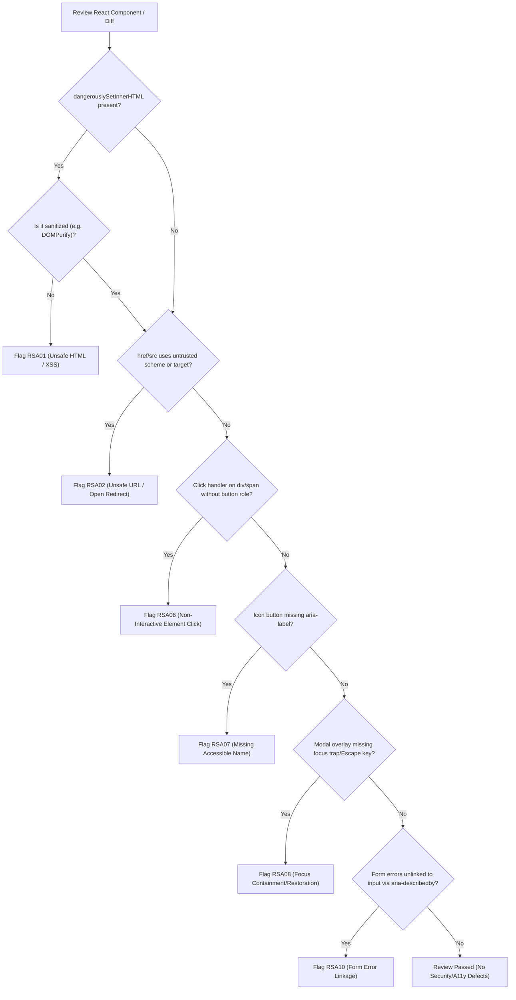

# React Security & Accessibility Review Checklist

## 1. Review Procedure & Triage Flow

---

## 2. Comprehensive Rule Catalog (`RSA01`–`RSA10`)

### `RSA01`: Unsanitized HTML & Dangerous DOM Sinks
- **Area**: React Security | **Severity**: CRITICAL | **Confidence**: HIGH
- **Requirement**: Any use of `dangerouslySetInnerHTML` must sanitize input using a proven sanitization library like DOMPurify.
- **Evidence**: `dangerouslySetInnerHTML={{ __html: untrustedVar }}` where `untrustedVar` is not sanitized.
- **Remediation**: `DOMPurify.sanitize(untrustedVar)` before rendering.

### `RSA02`: Unsafe URL Schemes & Unvalidated Navigation
- **Area**: React Security | **Severity**: HIGH | **Confidence**: HIGH
- **Requirement**: External links, `href`, and redirects must validate protocol schemes to forbid `javascript:` and `data:`.
- **Evidence**: `<a href={userProvidedUrl}>` or `router.push(userUrl)` without protocol validation.
- **Remediation**: Validate protocol against `['http:', 'https:', 'mailto:']`.

### `RSA03`: Client-Side Only Authorization Assumptions
- **Area**: React Security | **Severity**: MEDIUM | **Confidence**: MEDIUM
- **Requirement**: Client-side UI role checks (`user.role === 'admin'`) must not be treated as security enforcement without backend validation.
- **Evidence**: Sensitive API call triggered from UI assuming frontend component hiding enforces access control.
- **Remediation**: Ensure backend endpoints independently enforce role-based access control.

### `RSA04`: Sensitive Data Exposure & Insecure Storage
- **Area**: React Security | **Severity**: HIGH | **Confidence**: HIGH
- **Requirement**: Prevent storing private signing keys, backend secrets, or plaintext credentials in `localStorage` or client bundles.
- **Evidence**: Hardcoded backend API secrets in `.env` exposed to client bundle, or storing unhashed tokens in `localStorage`.
- **Remediation**: Use `HttpOnly` cookies and server-side secret management.

### `RSA05`: Cross-Origin Communication & Browser Security
- **Area**: React Security | **Severity**: HIGH | **Confidence**: HIGH
- **Requirement**: Message event listeners on `window` must strictly validate `event.origin`.
- **Evidence**: `window.addEventListener('message', ...)` handler consuming `event.data` without origin check.
- **Remediation**: Check `if (event.origin !== TRUSTED_ORIGIN) return;`.

### `RSA06`: Semantic JSX & Non-Interactive Element Clicks
- **Area**: React Accessibility | **Severity**: HIGH | **Confidence**: HIGH
- **Requirement**: Interactive click actions must use native `<button>` or provide `role="button"`, `tabIndex={0}`, and keyboard handlers.
- **Evidence**: `
` or `` with no keyboard listeners or role.
- **Remediation**: Replace with `<button type="button" onClick={...}>`.

### `RSA07`: Accessible Names & Programmatic Form Labels
- **Area**: React Accessibility | **Severity**: HIGH | **Confidence**: HIGH
- **Requirement**: Icon-only buttons must have `aria-label`; inputs must link to labels via `<label htmlFor={id}>` or `useId`.
- **Evidence**: `<button><Icon /></button>` without text or `aria-label`, or unlinked `<label>` and `<input>`.
- **Remediation**: Add `aria-label` or use `useId()` for `htmlFor`/`id` linking.

### `RSA08`: Modal Focus Containment & Restoration
- **Area**: React Accessibility | **Severity**: HIGH | **Confidence**: HIGH
- **Requirement**: Modal dialogs must trap keyboard focus, dismiss on `Escape`, and restore focus to trigger element upon closing.
- **Evidence**: Custom modal overlay lacking focus trapping and focus restoration logic.
- **Remediation**: Manage focus via `useRef`/`useEffect` or use an accessible primitive like Radix Dialog.

### `RSA09`: Dynamic Status Announcements & Live Regions
- **Area**: React Accessibility | **Severity**: MEDIUM | **Confidence**: HIGH
- **Requirement**: Asynchronous status updates and notifications must be announced using `aria-live` or `role="status"`.
- **Evidence**: Dynamic search result count or background save toast injected into DOM without `aria-live`.
- **Remediation**: Add `aria-live="polite"` or `role="status"` to status containers.

### `RSA10`: Form Error Association & Accessible Validation
- **Area**: React Accessibility | **Severity**: HIGH | **Confidence**: HIGH
- **Requirement**: Dynamic validation errors must be linked to inputs using `aria-describedby` and flagged with `aria-invalid="true"`.
- **Evidence**: Form error rendered as separate `` without `id` and missing `aria-describedby` on the input.
- **Remediation**: Add `aria-invalid={true}` and `aria-describedby={errorId}`.

---

## 3. False-Positive Filtering Checklist

Before finalizing any finding, check:
- [ ] Is `dangerouslySetInnerHTML` receiving hardcoded static text or pre-sanitized DOMPurify output? If yes, discard.
- [ ] Does the button already contain visible text? If yes, missing `aria-label` is not an issue.
- [ ] Is the dialog rendered using native `<dialog>` or Radix/Headless UI? If yes, focus management is handled natively.
- [ ] Is the data in `localStorage` merely a non-sensitive UI preference (theme/sidebar)? If yes, discard.

